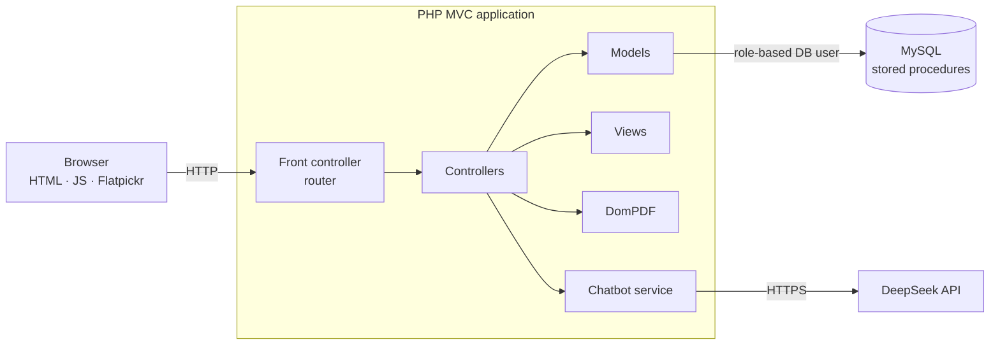

# DentBot — Dental Clinic Management System

Web application to manage a dental clinic: appointment scheduling, clinical records, dentist schedules, PDF documents and AI chatbots for patients and dentists.

DentBot is my university graduation project (proyecto de titulación, Ingeniería en Sistemas Computacionales, TecNM — Instituto Tecnológico de Lázaro Cárdenas), developed as a team since 2025.

> **The source code is in a private repository** owned by the team. This repository presents the project: features, architecture, business rules, the security audit I carried out and screenshots with test data. I can walk through the code in an interview.

**Stack:** PHP · MVC · MySQL (stored procedures, role-based DB users) · JavaScript · Flatpickr · DomPDF · DeepSeek API

<!-- TODO: add a short demo video or GIF here -->

---

## Screenshots

<!-- Add the images to screenshots/ with these names (see screenshots/README.md). Delete any line whose image you don't add. -->

| Appointment calendar | New appointment |
|---|---|
|  |  |

| Clinical record | Dentist schedule |
|---|---|
|  |  |

| Patient chatbot | Generated PDF |
|---|---|
|  |  |

## Features

| Module | What it does |
|---|---|
| Appointments | Receptionists book, view and cancel appointments; available slots are validated against the dentist's schedule |
| Clinical records | Patient record (expediente) viewer and a standalone progress sheet (Hoja de Evolución) |
| Dentist schedules | Shift configuration (on/off per shift) and vacation periods that block booking |
| Documents | PDF generation with DomPDF |
| Patient chatbot | Answers questions and books an appointment through a guided step-by-step flow |
| Dentist chatbot | Assistant for dentists, powered by the DeepSeek API |
| Access control | Application roles mapped to MySQL users with only the privileges each role needs |

## Architecture

- **MVC with a front controller:** every request goes through one router that dispatches to a controller.
- **Business rules close to the data:** scheduling checks run in **stored procedures**, so every entry point (receptionist screen or chatbot) applies the same rules.
- **Least privilege in the database:** each application role connects with its own MySQL user.

## Scheduling rules

| Rule | Detail |
|---|---|
| Duration by treatment | Regular appointments take 1 hour; surgeries take 2 hours |
| No overlaps | A dentist cannot have two appointments whose times overlap |
| Inside the shift | The appointment must start and end within one of the dentist's active shifts |
| Vacations | No appointments during a dentist's vacation period |
| Cancellation policy | Appointments can be cancelled up to 12 hours before they start |

The chatbot booking flow uses the same validation, so a patient cannot book a slot the receptionist could not.

## Security audit

I audited the patient chatbot and the modules around it and found **8 vulnerabilities**. Summary in [docs/security-audit.md](docs/security-audit.md).

| Finding | Mitigation |
|---|---|
| API key and service credentials hardcoded in source code | Recommended: move to configuration excluded from Git and rotate the keys |
| IDOR (access to other patients' data by changing an ID) | Ownership check on the server for every record request |
| Cross-site scripting (XSS) in rendered chatbot content | Output escaping before rendering |

I also fixed reliability issues in the chatbot: a duplicated-variable bug, permission errors and fragile JSON parsing of the model's responses.

## Project management and feasibility

- Work breakdown structure (WBS) and RACI matrices per module.
- Financial feasibility study: cash-flow projections, NPV, IRR, payback period and break-even analysis.

## My role

<!-- TODO: confirm each line; keep only what you did -->
- Appointment scheduling: booking screen, slot validation and stored procedures
- Dentist schedule configuration (shifts and vacations)
- Project planning (WBS, RACI) and financial feasibility study

- Alexander Rodríguez Del Valle — [GitHub](https://github.com/mclovinR) · [LinkedIn](https://www.linkedin.com/in/alexander-rodriguez-del-valle/)
